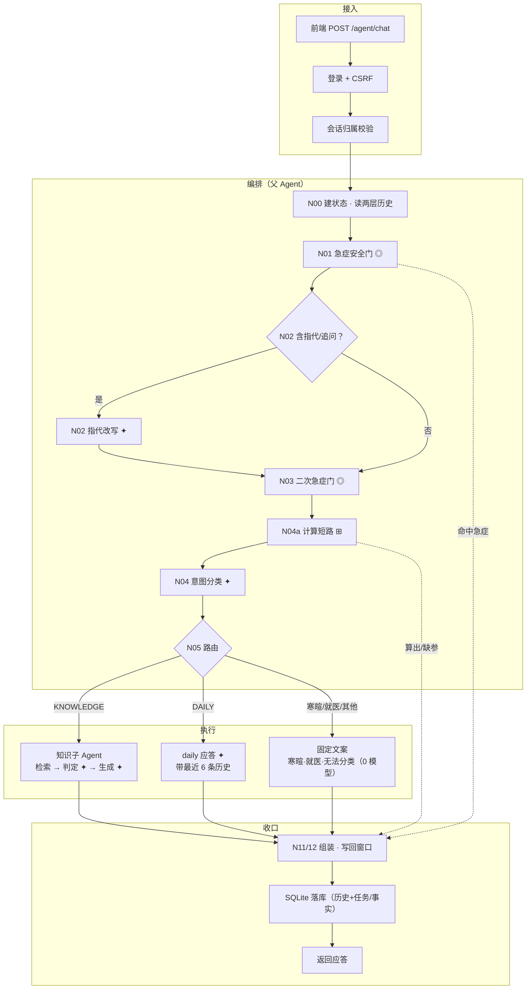

# 主 Agent 调用链流程图（项目理解）

> 依据 2026-10-29 当前代码静态梳理（含两次解耦：`finalize/resolver/daily/delegate`
> 拆分，意图识别独立为 `intent.py`）。节点标注真实文件与函数；
> `✦` = 模型调用点（单请求共 5 处），`◎` = 纯规则安全门，`⊞` = 确定性计算，
> 虚线 = 提前收口分支。

## 一、完整调用链

**唯一出口纪律**：`finalize.finish` 是所有分支（成功、急症、澄清、失败）的唯一
收口点——组装回答、写回会话窗口、落库都在其中完成。N02/N03/N04 的失败分支
同理提前进收口（图中从略）。

## 二、节点 → 代码位置

| 图中节点 | 文件 · 函数 | 干什么 |
|---|---|---|
| 接入三段 | `rag/main.py agent_chat` · `conversations.claim_or_verify` | 登录、归属（403 防枚举） |
| N00 | `session.acquire` · `context_engineering.begin_turn` | 内存 5 轮窗口 + SQLite 全量历史（3000 token 预算筛选） |
| N01 / N03 | `safety.check_emergency / check_crisis` | 急症与心理危机规则拦截 |
| N02 | `resolver.resolve_reference`（触发规则在 `router.py`） | 历史+本轮改写为独立问题，程序校验否定词/no-op |
| N04a | `calculator.detect` | BMI 等确定性计算，参数可跨轮补全 |
| N04 / N05 | `intent.classify` · `router.decide_route` | LLM 分类（不含历史，intent.py）→ 确定性路由表（router.py） |
| 知识子 Agent | `delegate.py` → `subagents/knowledge.py` → `rag/service.py` | 授权委派；检索 k=10 → 三段证据判定 → 生成；只传问题，不传历史 |
| daily 应答 | `daily.answer_daily` | 1 次轻量模型，带内存窗口最近 6 条；随后统一进收口返回 |
| 固定文案 | `intent.is_greeting` · `respond.*` | 纯寒暄规则短路（0 模型）；就医指引/无法分类同理 |
| 缺参返回 | `orchestrator N04a/N04 → finish` | 计算缺参、分类缺参 → 澄清文案 → 统一进收口返回 |
| 收口 / 落库 | `finalize.finish` · `main.py append_turn` | 所有出口唯一收口点：组装回答、写窗口、全量历史与任务/事实入库 |

## 三、三条关键区分（读图前提）

1. **DB 全量历史 ≠ 模型可见上下文**：`list_messages` 读出的历史要经
   `build_context` 的 3000 token 预算与相关性筛选，只有子集进入 N02 的改写
   Prompt；生成 Prompt 完全不含历史。
2. **AgentState ≠ 长期记忆**：每请求新建、请求结束即弃。跨请求的只有
   `agent_tasks` / `user_facts`（仅限 BMI 等计算参数补全），无跨会话用户记忆。
3. **检索到 ≠ 进入 Prompt**：chunks 必须过三段判定（距离粗筛 → 模型判定 →
   逐字引文校验）才被注入 `generate_answer`；任一不过即走证据不足固定文案。
