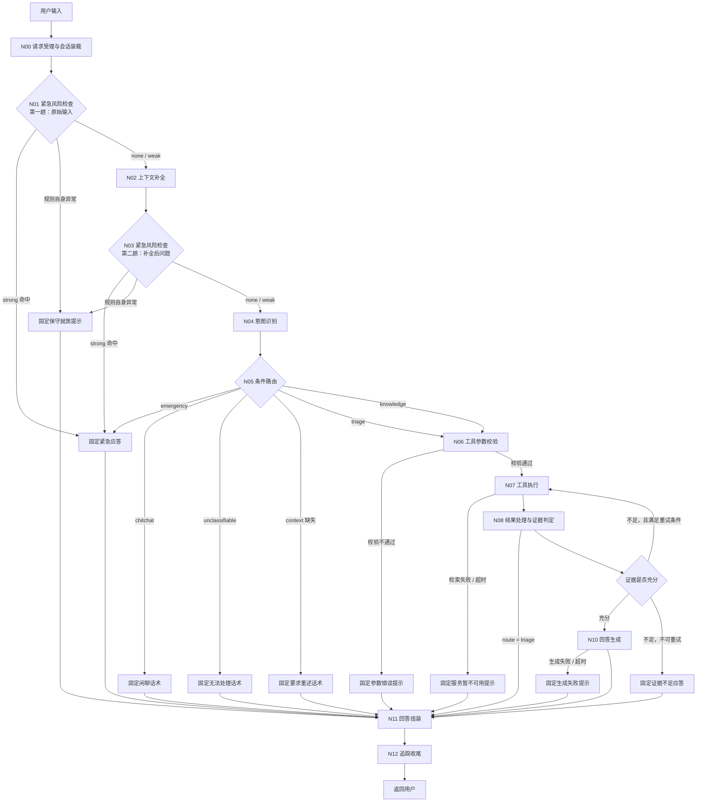
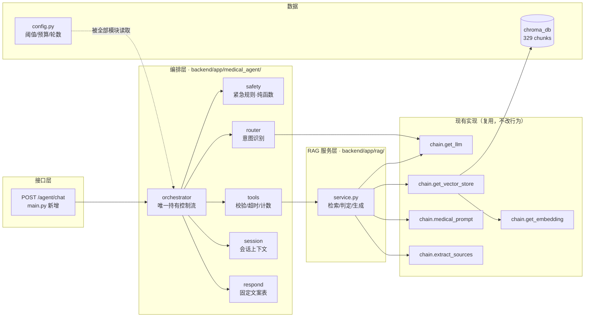

# 主 Agent 与 F4 路由编排 · 技术设计文档

**版本：** V1.1（依 2026-10-15 评审意见修订，修订点见文末「评审意见回应」）
**日期：** 2026-10-15
**文档状态：** 技术设计，**未经评审通过，尚未实现**
**上游依据：**

- `docs/普通用户版_V1.0_产品需求.md` —— 需求基线。本文不修改该文件。
- `docs/汇总.md` —— 仓库实测盘点结论。**本文不重复盘点**，直接在其结论上做设计。
- `docs/开发进度.md` —— 进度日志。

**本轮边界：只输出设计，不修改任何代码。** 评审通过前不进入编码。

---

# 第一部分：总体架构

## 1.1 主 Agent 完整执行流程



**读图要点：**

- 所有终止路径**汇聚到 N11**，不存在流程悬空的分支；N12 是唯一出口。
- 紧急路径（R_EMG / R_MED）在 N07 之前终止，**不经过检索**，因此知识库有无资料在结构上无法影响紧急结论。
- `N09 → N07` 是唯一的回边，守卫条件见 2.2；回边最多触发 1 次。
- N08 之后 triage 直接跳 N11，不进入证据判定（就医指引不依赖知识库）。
- 每个节点启动前除检查剩余预算外，还须按 5.6 的规则分配环节预算；预算不足时**不启动该环节**，直接走其降级分支。

## 1.2 模块调用关系



调用方向**严格单向、无环**：`orchestrator → {safety, router, tools, session, respond}`，`tools → service → chain`。`state.py` 只含数据类，被以上全部引用，不含逻辑。

## 1.3 模块职责、输入、输出与依赖

| 模块 | 核心职责 | 输入 | 输出 | 依赖 |
|:---|:---|:---|:---|:---|
| `main.py` `/agent/chat` | 接收请求、生成 `request_id`、把结果序列化为响应 | `{session_id, question}` | `{answer, sources, category, outcome, request_id}` | orchestrator |
| `orchestrator.py` | 按 N00–N12 顺序执行，**唯一决定分支走向的地方**；分配环节预算 | `AgentState` | 终态 `AgentState` | 其余全部模块 |
| `safety.py` | 急症词命中与强弱分级、否定处理。**纯函数、无 LLM、无 IO** | 文本 + 词表配置 | `EmergencyHit` | config |
| `router.py` | 寒暄短路、LLM 结构化分类、类别置信校验、路由表 | `resolved_question` + 紧急结果 | `category` + `route` | chain.get_llm |
| `tools.py` | 工具注册表、参数 Schema 校验、轮数/重复调用拦截、异常归一化、环节预算执行 | 工具名 + 原始参数 + 可用预算 | `ToolCallRecord` | service |
| `session.py` | 按 `session_id` 存取最近 N 轮、会话级并发串行、超限截断标记 | `session_id` | `history` + `context_status` | 无 |
| `respond.py` | 全部固定文案常量（9 类），禁止内联字符串 | — | 文案常量 | 无 |
| `state.py` | `AgentState` 及全部枚举 / 记录类型 | — | 数据类 | 无 |
| `rag/service.py` | 检索（带距离与度量元信息）、证据判定（三重校验）、基于证据生成 | question / docs | `[(Document, distance)]` / 判定 / 答案 | chain.* |
| `config.py` | 阈值、环节预算、轮数、路径、开关 | — | 配置常量 | `.env` |

## 1.4 为什么不采用其他两项候选方案

### 候选一：编排层实现方式

| 方案 | 说明 | 结论 |
|:---|:---|:---|
| **A. 显式 Python 流程（推荐）** | `orchestrator.py` 中顺序调用 + 条件分支 | **采用** |
| B. LangGraph 状态图 | 节点 + 条件边 + 状态合并 | 暂不采用，见第五部分 |
| C. LLM 自主 tool-calling 循环 | `while True` + 模型决定下一次调用 | **不采用** |

**选 A 的理由：**

1. 需求 AG-02 要求「每个工具必须写明什么情况下才允许调用，不允许模型觉得需要就调」。A 方案里调用条件是代码里的 `if`，天然满足；C 方案需要额外机制才能约束模型自主发起调用。
2. 需求 AG-05/AG-06 要求终止条件明确、轮数上限真实生效。A 方案的轮数上限在代码里是常量，不存在"模型不肯结束"的失控形态；C 方案必须靠外部计数器兜底。
3. 需求 F4 要求「简单问题不做无意义的多轮调用」。A 方案的闲聊路径是 **0 次 LLM、0 次工具**，路径长度在编译期就确定。
4. 本项目问题类别固定为 5 类，且安全判定必须确定性可审计。引入图编排框架换不来表达能力，只换来概念负担。

**主要代价：** 新增问题类别时需要改代码而非改配置；节点间没有自动的状态持久化。

**暂不选 C 的额外原因：** C 方案下"要不要检索"由模型决定，而"证据是否充分"必须由确定性判定决定。两者混在同一个循环里，会出现"模型自己判断检索够了"绕过证据闸门的风险 —— 这是本产品最不可接受的失败方式。

### 候选二：证据充分性判定方式

| 方案 | 说明 | 结论 |
|:---|:---|:---|
| **A. 三重校验（推荐）** | 距离粗筛 + 引用真实性校验 + 答案支撑性判定（+ 可选的生成后核验） | **采用** |
| B. 纯距离阈值 | 只比距离 | 不采用 |
| C. 纯模型判别 | 只让 LLM 判断"够不够" | 不采用 |

**选 A 的理由：** `docs/汇总.md` 第 4 节实测发现「血压的正常范围」以距离 0.596 命中氨氯地平说明书，而该文档**并不包含所问的答案**。B 方案会把它判为"充分"，直接导致编造。C 方案虽然能识别，但判定无确定性依据、不可复现，且模型异常时无从降级。A 方案用距离做前置粗筛（挡住明显无关、省一次 LLM），用模型做语义判断，并用逐字引用校验防止模型伪造证据。

**主要代价：** 每条知识问答多 1 次 LLM 调用（约 +2~5s 延迟、+1 次计费）。

**A 方案的保证限度（重要，见 5.5）：** 逐字校验能**证明**引用文字真实存在；但"引用回答了用户所问"只有模型判定，**不是形式化保证**。这一点在 5.5 单独说明。

### 候选三：紧急风险识别方式

| 方案 | 说明 | 结论 |
|:---|:---|:---|
| **A. 纯规则（推荐）** | 词表 + 主语标记 + 否定处理，纯函数 | **采用** |
| B. 规则 + LLM 兜底 | 规则未命中时交给模型判断 | 不采用 |

**选 A 的理由：** 需求 FR-04 明确「紧急判定应为确定性规则，保证可复现、可审计」；需求 9.3.5 要求「判定不确定但存在风险可能时，按紧急处理」。B 方案把安全底线交给了不保证可复现的组件，且模型超时/不可用时会同时失去兜底能力 —— 用一个会故障的组件去保护最重要的边界。

## 1.5 哪些决策不交给 LLM

| 决策 | 由谁做 | 理由 |
|:---|:---|:---|
| 是否紧急、紧急等级 | **确定性规则** | 需求要求可复现、可审计；且必须不依赖模型可用性 |
| 路由到哪条路径 | **确定性表** | 类别 → 路径是固定映射，无判断空间 |
| 工具参数是否合法 | **Schema 校验** | 合法性是形式问题，不需要语义理解 |
| 是否允许再次调用工具 | **计数器 + 重复检测** | 需求 AG-05/AG-06 |
| 距离是否过粗筛 | **确定性阈值**（未校准时禁用） | 数值比较，无需模型 |
| 引用是否真实存在 | **字符串逐字校验** | 这是形式化可判定的问题 |
| 引用是否回答了问题 | **LLM 判定 + 抽样人工核验** | 只有这一层依赖模型语义，且不声称形式化保证 |
| 来源展示什么 | **元数据直取** | 需求 FR-03：来源不允许由模型生成 |
| 异常时返回什么 | **固定文案表** | 需求 FR-08：异常不得降级为编造回答 |
| 环节预算是否够 | **确定性算术** | 不需要模型参与 |
| 最终回答的措辞 | **LLM** | 这是真正需要语言能力的部分 |
| 用户问题的类别归属 | **LLM（一次结构化分类）** | 自然语言意图理解需要模型 |
| 追问的指代消解 | **LLM（条件触发）** | 同上 |

**一句话概括：** LLM 只负责「理解用户说了什么」和「把证据组织成人话」，其余全部是确定性代码。

---

# 第二部分：F4 节点设计

## 2.1 节点总表

执行顺序为 N00 → N12。所有节点的写入/读取关系见第三部分。

| 节点 | 核心职责 | 输入 | 输出 | 调 LLM | 调工具 | 成功下一步 | 失败/异常处理 | 允许结束 |
|:---|:---|:---|:---|:---:|:---:|:---|:---|:---:|
| **N00** 请求受理与会话装载 | 生成 `request_id`；按 `session_id` 取历史；写入 deadline、分配首个环节预算 | `{session_id, question}` | `raw_question`、`history`、`context_status`、`deadline` | 否 | 否 | N01 | 参数缺失 → 400 参数错误文案，**不进入编排**；会话被占用超时 → 降级为无历史模式并在回答中说明 | 是 |
| **N01** 紧急风险检查（原文） | 对**本轮原始输入**跑急症规则，含否定处理 | `raw_question` | `emergency`（strong/weak/none） | 否 | 否 | strong → N11；none/weak → N02 | **规则自身异常**（词表加载失败、正则异常）→ 保守就医提示 → N11 | 是 |
| **N02** 上下文补全 | 把「那它的副作用呢」补成独立完整问题 | `history` + `raw_question` | `resolved_question`、`context_status` | 条件触发（有历史且含指代词） | 否 | N03 | 预算不足或 LLM 失败/超时 → `resolved_question = raw_question`，`context_status = missing` | 否 |
| **N03** 紧急风险检查（补全后） | 对补全后问题**再跑一次**规则，取 N01/N03 中更强者 | `resolved_question` | `emergency`（合并） | 否 | 否 | strong → N11；none/weak → N04 | 同 N01 | 是 |
| **N04** 意图识别 | 寒暄规则短路 → LLM 结构化分类 → 置信校验 | `resolved_question` | `category`、`category_confidence` | 是（寒暄命中时为否） | 否 | N05 | 预算不足 / 输出非法 / 置信不足 / 超时 / 异常 → `unclassifiable` | 否 |
| **N05** 条件路由 | 按 2.2 表写入 `route`，记录决策 | `category`、`emergency`、`context_status` | `route` | 否 | 否 | 见 2.2 | 无匹配条件 → `unclassifiable` 兜底 | 是 |
| **N06** 工具参数校验 | 按 Schema 校验；不通过则**不发出调用** | 工具名 + 原始参数 | `ToolCallRecord(INVALID_ARGS)` 或放行 | 否 | 否 | 校验通过 → N07 | 校验不通过 → 固定参数错误提示 → N11 | 是 |
| **N07** 工具执行 | 在环节预算内执行；重复调用与轮数拦截 | 校验后的参数 + 可用预算 | `ToolCallRecord` + `retrieval` | 否 | **是** | N08 | 超时/异常/空结果 → 记录并 → N08 分流；预算不足或连续失败达阈值 → 服务不可用提示 → N11 | 是 |
| **N08** 结果处理与证据判定 | 归一化工具返回；三重校验判定证据；提取来源 | `retrieval`、`route`、可用预算 | `evidence`、`sources` | 是（Gate 2-b；`EVIDENCE_JUDGE=threshold` 或预算不足时为否） | 否 | route=triage → N11；route=knowledge → N09 | **判定环节任何异常 → 一律判为 insufficient**（保守降级） | 否 |
| **N09** 继续或结束判定 | 唯一的回边守卫：判断是否再检索一次 | `evidence`、`tool_rounds`、`tool_calls`、剩余预算 | 下一步目标 | 否 | 否 | 充分 → N10；可重试 → N07；不可 → N11 | 三个守卫条件任一不满足即视为不可重试 | 否 |
| **N10** 回答生成 | 以证据为唯一事实来源生成正文 | `resolved_question`、`evidence.docs`、可用预算 | `answer_text` | **是** | 否 | N11 | 预算不足 / 超时 / 异常 → 生成失败提示 → N11 | 是 |
| **N11** 回答组装 | 正文 + 来源 + 风险提示 + 免责声明，按固定顺序拼接 | 各分支产物 | 最终用户可见文本 | 否 | 否 | N12 | 组装本身不抛异常；缺件按分支降级文案补齐 | 否 |
| **N12** 追踪收尾 | 写 `termination_reason`、输出 trace、更新会话 | 全量 `trace` | 日志 + 会话更新 | 否 | 否 | 返回用户 | 日志/会话写入失败**不影响响应**，只记内部告警 | 是 |

**「允许结束」列的含义：** 标记为「是」的节点，可以在自身处理完后直接跳 N11 终止；标记为「否」的节点必须交棒给下一个节点，不允许在此中断流程。

## 2.2 条件路由判断表（N05）

| 优先级 | 判断条件 | 目标 | 说明 |
|:---:|:---|:---|:---|
| 1 | `emergency.level == strong` | N11（紧急应答） | 实际已在 N01/N03 拦截，本行是防御性冗余 |
| 2 | `context_status == missing` 且 `resolved_question` 仍含未消解指代 | N11（要求重述） | 需求 FR-06 边界：不得猜测指代对象 |
| 3 | `category == chitchat` | N11（闲聊话术） | **0 工具、0 LLM**（寒暄规则命中时） |
| 4 | `category == unclassifiable` | N11（无法处理话术） | 需求 FR-05 边界：不得强行归入某一类 |
| 5 | `category == triage` | N06 → N07 → N08 → N11 | 走就医指引工具，**不进证据判定** |
| 6 | `category == knowledge` | N06 → N07 → N08 → N09 | 走 RAG 与三重校验 |
| 兜底 | 以上均不匹配 | N11（无法处理话术） | 不存在"默认进知识库问答"的分支 |

**N09 回边守卫（四个条件须同时满足，否则结束）：**

1. `evidence.sufficient == false` **且** `evidence.stage1_passed == true`（第 1 段就没过，重试无意义，直接结束）
2. `tool_rounds < MAX_TOOL_ROUNDS`
3. 剩余预算 `≥ MIN_USABLE_BUDGET + TOOL_BUDGET`（预算不够就不启动新一轮）
4. 本次不是「同工具 + 同参数」的重复调用

重试时使用**改写后的 query**（`resolved_question` 的标准化形式）而非原句，这是唯一的重试手段。

## 2.3 紧急风险检查的实现策略（N01 / N03）

### 为什么是两趟

| 趟次 | 位置 | 目的 |
|:---|:---|:---|
| 第一趟 | N01，上下文补全**之前** | 零成本、零延迟先拦一道，避免疑似急症被 N02 的 LLM 调用拖延 |
| 第二趟 | N03，上下文补全**之后** | 捕获跨轮指代：上一轮说「胸口疼」，本轮说「要挂哪个科」 |

两趟都是纯规则，额外开销可忽略。合并结果取**更强**的一档。

### 分级规则（确定性、可测试）

| 情形 | 判定 | 行为 |
|:---|:---|:---|
| 命中急症词 ∧ 有主语/时态标记（`我｜本人｜现在｜刚才｜突然｜一直`）∧ 无否定词 ∧ 无元问题标记 | **strong** | 直接返回紧急应答，终止流程 |
| 命中急症词 ∧ 有否定词（`不｜没｜没有｜无｜未`，位于词前 3 字窗口内） | **none**（记 `hit_negated=true`） | 不拦截，走常规流程 |
| 命中急症词 ∧ 有元问题标记（`说明书｜是否提到｜副作用里｜禁忌｜这个药会不会`） | **weak** | 不拦截，常规流程 + 回答顶部加风险提示 |
| 命中急症词 ∧ 无任何标记 | **weak** | 同上（保守但不误拦） |
| 同时命中否定词与强主语标记（如「我没有胸痛但现在突然喘不上气」） | **strong** | **保守优先**：按需求 9.3.5「判定不确定但存在风险可能时，按紧急处理」 |

> **本表第 4 行是可配置的安全档位，需评审确认。** 只有症状词、没有任何主语或时态标记的裸输入（如「胸痛」）目前定为 weak（不拦截、加提示）。若评审认为按需求 9.3.5 应更保守，改为 strong 只需调整配置 `EMERGENCY_BARE_SYMPTOM_LEVEL`，不改代码。

急症词表初值（外置为配置，≥8 条，对应 FR-04 验收）：胸痛 / 胸闷剧痛、呼吸困难 / 喘不上气、意识障碍 / 昏迷 / 抽搐、大出血 / 呕血 / 咯血、剧烈头痛、言语不清 / 一侧无力、误服过量、高热惊厥。

### 关于「模型异常」

本节点**不调用任何模型**，因此「模型异常」在本节点不适用 —— 这正是选择纯规则方案要消除的风险（见 1.4 候选三）。

真正需要覆盖的异常是**规则引擎自身**：词表文件加载失败、正则编译异常、配置项缺失。处理策略统一为：**保守降级为就医提示**，即返回「您描述的情况需要当面评估，建议尽快前往医院就诊」，**不继续常规问答**。此路径与「知识库无资料」完全无关（需求 FR-04 第 5 条边界）。

---

# 第三部分：状态与数据结构

## 3.1 `AgentState`（每请求新建一次，不跨请求复用）

| 字段 | 类型 | 写入节点 | 读取节点 | 说明 |
|:---|:---|:---|:---|:---|
| `request_id` | `str` | N00 | 全部（日志） | 请求标识，全链路追踪锚点 |
| `session_id` | `str` | N00 | session、N12 | 会话标识 |
| `turn_id` | `int` | N00 | N12 | 本会话内轮次序号 |
| `raw_question` | `str` | N00 | N01、N02 | 用户本轮原始输入 |
| `history` | `list[Turn]` | N00（由 session 取出） | N02 | 最近 N 轮，已截断；一轮定义见 3.5 |
| `context_status` | `enum` | N00、N02 | N05、N11 | `ok` / `missing` / `not_needed` / `degraded_no_history` |
| `resolved_question` | `str` | N02 | N03、N04、N07、N08、N10 | 补全后的问题 |
| `emergency` | `EmergencyHit` | N01、N03 | N05、N11 | `{level, rule_id, terms, hit_negated}` |
| `category` | `enum` | N04 | N05 | 5 类之一 |
| `category_confidence` | `float` | N04 | N04（自行判断阈值） | 低于阈值即判 `unclassifiable` |
| `route` | `enum` | N05 | N07、N08、N09、N11 | 最终执行路径 |
| `tool_rounds` | `int` | N07 | N09 | 已消耗轮数 |
| `tool_calls` | `list[ToolCallRecord]` | N07 | N07（重复检测）、N09、N12 | 全部调用记录，含失败 |
| `consecutive_failures` | `int` | N07 | N07（自我终止） | 连续失败计数 |
| `retrieval` | `RetrievalResult` | N07 | N08、N12 | `{outcome, docs_with_scores, distance_metric, latency_ms}` |
| `evidence` | `EvidenceJudgement` | N08 | N09、N10、N11、N12 | 见 3.2 |
| `sources` | `list[Source]` | N08 | N11 | 取自 `Document.metadata` |
| `answer_text` | `str` | N10、N11 | N11、N12 | 用户可见正文 |
| `risk_notice` | `str \| None` | N11 | N11 | 弱信号时非空 |
| `budget` | `BudgetState` | N00 起，逐环节更新 | N02、N04、N07、N08、N10 | `{deadline, remaining_ms, node_budget_ms}` |
| `termination_reason` | `enum` | N12 | 日志 | 见 3.3 |
| `error` | `AgentError \| None` | 任意节点 | N11、N12 | 归一化后的异常 |
| `trace` | `list[TraceRecord]` | 全部节点 append | N12 | 见 3.4 |

**字段取舍说明：** 未包含任何当前业务用不到的字段 —— 没有多智能体路由字段、没有用户账号字段、没有跨会话字段、没有指标解释字段（FR-09 属 P1）。

## 3.2 关键结构体

```python
# 检索结果状态：互斥，不可混用
class RetrievalOutcome(Enum):
    SUFFICIENT       = "sufficient"        # 检索成功 且 证据充分
    INSUFFICIENT     = "insufficient"      # 检索成功 但 证据不足（无依据）
    EMPTY_RESULT     = "empty_result"      # 检索成功 但 返回 0 条
    RETRIEVAL_ERROR  = "retrieval_error"   # 检索执行失败 / 超时
    GENERATION_ERROR = "generation_error"  # 生成失败 / 超时

class ToolStatus(Enum):
    OK                 = "ok"
    INVALID_ARGS       = "invalid_args"        # 未发出调用
    TIMEOUT            = "timeout"
    RUNTIME_ERROR      = "runtime_error"
    BLOCKED_REPEAT     = "blocked_repeat"      # 重复调用被拦截
    BLOCKED_MAX_ROUNDS = "blocked_max_rounds"
    BLOCKED_BUDGET     = "blocked_budget"      # 预算不足，未启动

class EmergencyLevel(Enum):
    STRONG = "strong"   # 拦截
    WEAK   = "weak"     # 加风险提示
    NONE   = "none"

# 证据判定：三段独立记录，便于定位是哪一段拦下的
class EvidenceJudgement:
    stage1_gate1: Optional[bool]   # 距离粗筛；None = 未校准，本段未启用
    stage2_quote_verified: bool    # 引用逐字存在于片段中（形式化校验）
    stage3_answerable: Optional[bool]  # 模型判定"片段包含回答所问的依据"
    supporting_quote: Optional[str]
    top1_distance: Optional[float]
    distance_metric: Optional[str]
    sufficient: bool               # 最终结论
    reason: str                    # 定位用，不含用户原文

class ToolCallRecord:
    seq: int
    tool: str
    args_digest: str        # 参数摘要（长度 + 短 hash），不记原文
    status: ToolStatus
    latency_ms: int
    budget_ms: int          # 本环节分配到的预算
    round: int
```

## 3.3 终止原因枚举（保证所有路径都有明确结果）

```python
class TerminationReason(Enum):
    COMPLETED              # 正常回答完成
    EMERGENCY_HANDLED      # 紧急应答已给出
    EMERGENCY_RULE_FAULT   # 规则异常，保守就医提示
    INSUFFICIENT_EVIDENCE  # 证据不足
    EMPTY_KNOWLEDGE_BASE   # 知识库空
    RETRIEVAL_FAILED       # 检索失败
    GENERATION_FAILED      # 生成失败
    UNCLASSIFIED           # 无法处理
    CONTEXT_MISSING        # 上下文缺失，要求重述
    ARGUMENT_INVALID       # 工具参数不合法
    MAX_ROUNDS_REACHED     # 达到轮数上限
    REPEATED_CALL_BLOCKED  # 重复调用被拦截
    BUDGET_EXHAUSTED       # 整体预算耗尽（含环节预算不足未启动）
```

十三种终止原因与 N11 的固定文案**一一可映射**，因此不存在"流程走完了但不知道返回什么"的情况。

## 3.4 追踪记录

```python
class TraceRecord:
    seq: int
    node: str                    # N00~N12
    event: str                   # decision / budget / tool_call / judge / error
    detail: dict                 # 决策结果、工具名、状态、判定段、outcome、轮数
    latency_ms: int | None
    budget_left_ms: int | None
    node_budget_ms: int | None   # 本环节分配到的预算，用于定位"是预算不足还是真失败"
```

## 3.5 会话边界与隔离（V1.0 定义）

### 「一轮」的明确定义

**一轮 = 一条用户消息 + 其对应的一条助手回复，共 2 条消息。**

- `MAX_CONTEXT_TURNS = 5` ⇒ 底层 `deque(maxlen = 2 × 5 = 10)`，即 10 条消息。
- 只存 `user` / `assistant` 两种角色；不存 system、不存 trace、不存工具原始返回。
- 助手回复超长时按配置截断（只保留摘要长度），避免历史膨胀挤占 Prompt。

### V1.0 运行边界（明确声明）

| 项 | V1.0 的界定 | 后果 |
|:---|:---|:---|
| 部署形态 | **单进程、单 worker**（`uvicorn ... --workers 1`） | 多 worker 时同一 `session_id` 可能落到不同进程，读到各自的历史 |
| 启动自检 | 读取 `WEB_CONCURRENCY`；`> 1` 时记录启动告警，并**将会话功能降级为无历史模式** | 宁可明确降级，也不提供"看起来有上下文、实际片段化"的历史 |
| 服务重启 | 进程内存清空，历史丢失 | 收到已知 `session_id` 但本地无记录 → `context_status = missing` → 走"请重述"文案，**不静默当作新会话**（否则指代追问会得到答非所问的结果） |
| 触发重述提示的前提 | 前端需持久化 `session_id`（如 localStorage）并在重启后继续使用 | 此项需要前端配合，属前端改动范围，见待确认 C-6 |
| 跨会话 | 严格按 `session_id` 分桶，**不共享任何历史** | — |
| 是否引入 Redis | **不引入** | 会话读写集中在 `session.py` 一个模块内，后续替换只需改这一个文件（不为此引入协议/抽象层） |

### 并发与串扰防护

| 风险 | 防护措施 |
|:---|:---|
| 不同请求共享状态 | `AgentState` 是 `run_agent()` 的**局部变量**，不存模块级；模块级只允许存在不可变配置与只读客户端 |
| 不同会话共享历史 | `session.py` 内部 `dict[session_id, deque]`，取值按 `session_id` 精确命中 |
| **同一会话并发写** | 锁粒度 = `session_id`：同一会话的读-改-写串行化；**不同会话不互相阻塞** |
| 锁等待拖垮请求 | 取锁设超时（2s）；超时则该请求降级为 `context_status = degraded_no_history`，照常回答但明确告知"本次未使用历史对话"，不静默 |
| 历史无限增长 | `deque(maxlen=10)` 自动丢弃，并置 `context_status = missing` |
| 陈旧会话占用内存 | 会话条目带 `last_active`，超过空闲阈值清理 |

---

# 第四部分：异常处理与安全边界

以下情况逐一说明**内部处理**与**用户最终看到什么**。所有用户可见文案取自 `respond.py` 常量表，**不得内联、不得拼接异常对象**。

| # | 场景 | 内部处理 | 用户最终看到的结果类型 |
|:---:|:---|:---|:---|
| 1 | **正常知识问答，RAG 找到有效证据** | N05→N06→N07→N08 三段校验通过→N09 结束→N10 生成→N11 组装 | 正文 + 来源（文档名，可提供时含页码）+ 免责声明。**回答中每条医学结论必须能在所展示的来源片段中找到对应文字** |
| 2 | **RAG 没有找到有效证据** | N08 判定不通过（第 1 段距离粗筛不过 / 第 3 段模型判为不可回答 / 引用校验失败）→ 记录 `INSUFFICIENT` → 满足守卫则重试 1 次 → 仍不过 → N11 | 固定文案「知识库暂无该问题的足够依据，无法据此给出结论」，**不含任何具体医学结论**；检索到的片段仅记入内部 trace，不进回答 |
| 2b | **检索到相关文档，但文档未回答所问**（如问"血压正常范围"，命中氨氯地平说明书但只有量效数据） | 第 3 段判定为不可回答 → `INSUFFICIENT` → 同上 | 同第 2 条。**这是本方案最需要重点覆盖的场景**，测试见 T-02b（门禁） |
| 3 | **RAG 检索执行失败** | N07 捕获异常 → `ToolStatus.RUNTIME_ERROR` → `outcome = RETRIEVAL_ERROR` | 固定文案「知识库检索服务暂时不可用，请稍后重试」。**与第 2 条措辞不同**（需求 FR-08 边界） |
| 3b | **检索成功但返回空结果** | N07 未抛异常、返回 0 条 → `outcome = EMPTY_RESULT` | 固定文案「知识库暂无相关资料」。**与第 2、3 条均不同** |
| 4 | **模型调用失败或超时** | 分环节处理：N02 失败→`context_status=missing`；N04 失败→`unclassifiable`；N08 第 3 段失败→**保守判 insufficient**；N10 失败→`GENERATION_ERROR`。**不存在"整条链路共用一个超时"的写法**，各环节用 5.6 的独立预算 | 上下文补全失败：照常回答，并说明"本次未使用历史对话"；分类失败：「暂时无法理解您的问题，请换一种说法」；判定失败：证据不足文案；生成失败：「回答生成服务暂时不可用，请稍后重试」。**四者都不含医学结论，都不输出堆栈/密钥/路径** |
| 5 | **意图识别结果不确定** | N04 四类都归入 `unclassifiable`：① 模型显式返回"无法归类"；② `category_confidence < 阈值`；③ 输出不是合法枚举值；④ 环节预算不足未启动。**不得取最接近的一类** | 固定文案「抱歉，暂时无法理解您的问题属于就医咨询还是健康知识查询，请补充说明您想了解什么」，并提示可以换一种说法 |
| 6 | **疑似紧急症状** | N01 / N03 命中 strong → **不检索、不生成**，直接进 N11 | 简短医疗行动指引（立即前往急诊 / 拨打 120）+ **不含病因判断** + **不含用药建议**。需求 9.3.2：使用"立即前往"这类明确表述，不用"建议咨询医生"这类弱化说法 |
| 7 | **工具参数不合法** | N06 Schema 校验不通过 → `ToolStatus.INVALID_ARGS` → **不发出调用** | 固定文案「本次查询的参数不符合要求，请重新描述您的问题」。底层检索**未被调用**，trace 中可见"校验失败"记录 |
| 8 | **工具执行失败** | N07 超时 → `TIMEOUT`；抛异常 → `RUNTIME_ERROR`；重复调用 → `BLOCKED_REPEAT`。**三种状态都不得被当作成功**（AG-04） | 超时与异常：「知识库检索服务暂时不可用，请稍后重试」；重复调用：「本次查询未能获得更多信息，请补充或修改问题后重试」 |
| 9 | **重复调用或超过执行轮数** | N07 在**调用前**拦截：同工具 + 同 `args_digest` → `BLOCKED_REPEAT`；`tool_rounds ≥ MAX_TOOL_ROUNDS` → `BLOCKED_MAX_ROUNDS`。连续失败达阈值同样自我终止 | 按 AG-05 边界明确说明「未能完成本次查询，请补充信息或稍后重试」，**不静默截断**。若此前已获得可用证据，则输出当前最佳结果并在末尾注明回答可能不完整 |
| 9b | **预算耗尽** | 环节启动前按 5.6 分配：`环节预算 = min(配置预算, 剩余全局预算)`；`< MIN_USABLE_BUDGET` 时不启动该环节 → `BLOCKED_BUDGET` / `BUDGET_EXHAUSTED` | 若已完成生成：「回答可能不完整」提示 + 当前结果；若未完成生成：服务繁忙提示，建议稍后重试。**不返回半截回答** |
| 10 | **用户连续追问，需结合上下文补全** | 有历史且含指代词 → N02 调用 LLM 消解；历史超 `maxlen` 或服务重启 → `context_status = missing` → N05 第 2 条路由拦截 | 成功：与直接输入完整表述得到同样的回答与来源。上下文已丢弃：固定文案「较早的对话已不再保留，请把问题重新完整描述一次」，**不猜测指代对象**。跨会话：按 `session_id` 严格隔离，不串用 |

## 4.1 安全边界清单（必须始终成立）

| 边界 | 由什么保证 |
|:---|:---|
| 无证据不输出医学结论 | N09 守卫 + 三段校验；证据不足时 N10 根本不被调用 |
| 不伪造来源 | 来源直接取自 `Document.metadata`，**不经过模型**；检索为空时 `sources = []` |
| 引用文字必然真实 | 逐字字符串校验（形式化） —— **注意这不等价于"引用支持结论"，见 5.5** |
| 紧急提示不被跳过 | 紧急检查在 N07 之前完成，时序上无法被检索结果影响 |
| 异常时不产出编造回答 | `AgentError` → 固定文案映射表；证据判定环节任何异常一律降级为 insufficient |
| 不出现无终止条件的循环 | N09→N07 是唯一回边，守卫含计数与预算上限，最多触发 1 次 |
| 不泄露内部信息 | 用户可见文案为常量；响应体不含 `str(e)`、堆栈、密钥、路径 |
| 不越权给出诊断/处方 | 生成 Prompt 复用 `chain.py` 既有医疗 Prompt（含免责与"只用上下文作答"约束）；N10 的输入只有检索片段 |

---

# 第五部分：技术方案与实现范围

## 5.1 LangGraph 在当前场景中的职责

**结论：不引入。LangGraph 在本方案中承担零职责。**

理由：

1. 本方案的状态是一维顺序推进 + 一处回边，全部状态是**单个请求内的局部变量**，不需要跨请求的检查点、持久化或状态合并。
2. 现有两份 langgraph 代码（`backend/app/agent/workflow.py`、`backend/multi_agent_business/graph.py`）经盘点均为与医疗无关的演示，**不可复用**，引入等于从零学一遍。
3. 需求施工约束明确「不为了展示技术复杂度而增加不必要的节点、工具或抽象」，与本项目 CLAUDE.md 中「不提前引入不必要的复杂架构」一致。
4. `docs/汇总.md` 第 8 节已得出同一结论。

**审视边界（满足任一条件时重新评估迁移）：**

- 需要在节点之间**持久化状态**并支持断点恢复；
- 出现**多条回边或并行分支**，手写控制流开始难以追踪；
- 需要把不同节点拆到**不同进程/服务**，需要框架提供序列化边界。

当前 V1.0 三条都不满足。

## 5.2 图节点编排 vs 普通 Python 流程

| 维度 | 普通 Python 流程（采用） | 图节点编排 |
|:---|:---|:---|
| 分支可读性 | `if/elif` 直接可读，IDE 可跳转 | 需对照图定义与节点函数 |
| 调试 | 断点直接打在节点函数里，栈完整 | 需借助框架的追踪机制 |
| 轮数与预算控制 | 普通变量 + `deadline`，编译期可见上界 | 需在图外另设守卫，易被绕过 |
| 新增节点成本 | 加一个函数 + 一处分支 | 加节点 + 加边 + 改状态 schema |
| 状态校验 | 类型注解 + 数据类 | 框架内置（本项目规模用不上） |
| 可视化 | 本文档的 Mermaid 图即设计图 | 框架可自动生成图（收益有限） |
| 适用规模 | **≤ 15 节点、≤ 3 条回边** | 节点多、分支交织、需持久化 |

**分界线：** 本方案 13 个节点、1 条回边，落在普通 Python 的舒适区。当回边超过 3 条或需要状态持久化时，再迁移。

## 5.3 最小可行实现方案（按依赖顺序）

| 步骤 | 内容 | 完成标志 |
|:---:|:---|:---|
| **Step 0a** | 配置与依赖：`config.py` 集中配置；`chain.py` 三处小改（Prompt 与 `extract_sources` 提为模块级、`CHROMA_DIR` 与 timeout 读 config）；补齐 `requirements.txt` | 复验 `count == 329`；`/chat/stream` 行为**完全不变** |
| **Step 0b** | **距离度量确认与阈值校准**（见 5.4）；**检索与模型耗时实测**（见 5.6） | 产出《阈值校准报告》；`config.EVIDENCE_THRESHOLD` 与 `EVIDENCE_THRESHOLD_METRIC` 有实测依据；实测耗时填入预算表 |
| **Step 1** | `state.py` + `respond.py` + `safety.py`（纯规则，零依赖） | 紧急规则、否定处理、固定文案可单元测试 |
| **Step 2** | `rag/service.py`：带距离与度量元信息的检索 + 三段校验 + 基于证据生成 | 可独立验证"无依据问题不被判为充分"，含 T-02b |
| **Step 3** | `tools.py`：注册表、Schema 校验、环节预算执行、轮数与重复拦截 | 参数非法时底层检索**未被调用** |
| **Step 4** | `router.py` + `session.py` + `orchestrator.py` + `/agent/chat` | 端到端可跑通 13 节点流程 |
| **Step 5** | 测试补齐与门禁项确认（T-02b、T-09） | 见第六部分 |

**Step 0b 必须在 Step 2 之前完成** —— 否则阈值会带着未经确认的度量语义进入生产判定。

**明确不引入的抽象层：** 图编排框架、依赖注入容器、"工具基类体系"（两个工具用注册表 dict 即可）、事件总线、会话存储协议层。

## 5.4 距离度量确认与阈值校准（修订：回应评审意见 1）

### 为什么不能直接使用 0.85

盘点实测的距离（相关 0.53~0.80、无关 0.89~1.10、分界约 0.85）是用 **`langchain_community.vectorstores.Chroma`** 得到的；而本方案的生产路径使用 **`chain.get_vector_store()`（`langchain_chroma.Chroma`）+ `similarity_search_with_score`**。两者是不同实现，**不保证返回同一距离刻度**（Chroma 默认可为 L2 或 cosine，且是平方与否的差异会让数值相差数倍）。因此：

> **0.85 在校准完成前只能作为实验参数，不得作为生产判定标准。** 本方案不把它写死进配置默认值。

### Step 0b 的校准任务

1. 读取 collection 的真实距离度量：`collection.metadata.get("hnsw:space")`，记录到报告；
2. 用**与盘点同一批问题**（药品类问题 + 四类无依据问题各若干）跑 `similarity_search_with_score`，输出两个分布；
3. 判断与盘点值是否可比（同一度量 且 数值量级一致）：
   - 可比 → 阈值可从 0.85 附近起步并微调；
   - 不可比 → **必须重新校准**，不得沿用 0.85；
4. 产出《阈值校准报告》，记录：度量类型、样本清单、两类距离分布、所选阈值、选择依据、边界样本（落在灰区的问题）；
5. 只有报告完成后，才把数值填入 `config.EVIDENCE_THRESHOLD`，同时填 `EVIDENCE_THRESHOLD_METRIC`。

### 未校准时的 Fail-safe 机制（代码层保证，非约定）

| 状态 | 行为 |
|:---|:---|
| `EVIDENCE_THRESHOLD is None` | **第 1 段（距离粗筛）不参与判定**，仅记录 `top1_distance` 供观测；判定由第 3 段独立承担；trace 标记 `gate1=disabled_uncalibrated` |
| 启动自检发现 collection 的 `hnsw:space` 与 `EVIDENCE_THRESHOLD_METRIC` 不一致 | 记录告警并**自动禁用第 1 段**，不静默使用错误阈值的数值 |
| 两段都不可用（未校准 且 `EVIDENCE_JUDGE=threshold`） | 启动即报错退出，禁止在无判定能力的情况下提供服务 |

**结论：** 未校准时系统仍然可用（依赖模型判定），但**绝不会用未经确认的数值做判定**。

## 5.5 证据判定的三段结构与保证限度（修订：回应评审意见 2）

### 三段结构

| 段 | 检查内容 | 实现 | 性质 |
|:---:|:---|:---|:---|
| **第 1 段** | 距离粗筛：`top1_distance ≤ 阈值` | 确定性数值比较 | 形式化；**未校准时禁用**（见 5.4） |
| **第 2 段** | **引用真实性**：`supporting_quote` 逐字出现在片段中 | 字符串包含校验 | **形式化可证明** —— 能证明引用文字真实存在，能挡住模型编造引用 |
| **第 3 段** | **答案支撑性**：片段是否包含回答问题所需的依据 | LLM 结构化判定 `answerable: bool` + 要求给出 `supporting_quote`；要求模型在不确定时输出 `false` | **模型判断，非形式化保证** |
| **第 4 段（可选）** | **生成后引用支撑性核验**：回答是否引入了证据之外的医学结论 | 生成完成后一次 LLM 核验；不通过则降级为"证据不足"文案 | 模型判断；默认**关闭**（`GROUNDING_CHECK = off`），代价 +1 次 LLM |

**最终判定规则：** 第 1 段（若启用）∧ 第 2 段 ∧ 第 3 段（若 `EVIDENCE_JUDGE` 含 llm）全部通过才判 `sufficient`；任一段失败或不通过即判 `insufficient`。任一段抛异常 → **一律 insufficient**。

### 保证限度（必须写清楚，不得夸大）

| 命题 | 谁能证明 | 强度 |
|:---|:---|:---|
| 展示的来源文档名/页码真实存在 | 元数据直取 + 与知识库清单比对 | 形式化，测试 100% 可判 |
| 引用的文字确实在检索片段中 | 第 2 段字符串校验 | 形式化，可证明 |
| 被引用的片段**回答了用户所问的问题** | 第 3 段模型判定 + 抽样人工核验 | **非形式化保证**，存在模型误判为 true 的可能 |
| 生成的回答**未引入**证据之外的医学结论 | 第 4 段开启时由模型核验；关闭时仅依赖 N10 的 Prompt 约束 | 关闭时**无强制保证**，只有测试覆盖 |

**因此第 2 段（逐字校验）只是双重/三重校验中的一环，不是"证据充分"的充分条件。** 它解决的是"引用是不是编的"，不解决"引用是不是答非所问"。后者靠第 3 段，且第 3 段本身是模型判断。

### 第 4 段的启用门禁（强制条件，非建议）

`GROUNDING_CHECK` 默认 `off`，但下列任一情况成立时**必须改为 `on`**：

- 门禁测试 **T-02b**（检索到相关文档但文档未回答所问的问题）在第 3 段单独把关下**不通过**；
- 集成测试 T-16 的人工核对表出现"引用真实但未支撑结论"的条目；
- 任何一次真实使用中收到该类反馈。

代价为每条知识问答 +1 次 LLM 调用（典型 +2~5s）。以测试结果决定是否承担，而不是先验地关掉。

## 5.6 时间预算：逐环节分配（修订：回应评审意见 3）

### 原设计的问题

原方案写「单次 LLM 15s + 整体请求 30s」，但正常知识问答路径**串行**执行 N02(可选) + N04 + N07 + N08 + N10 共 4~5 个环节。按上限相加会超过 30s，**整体上限形同虚设**；而且"每个节点前检查剩余时间"只能提前放弃，不能保证正常路径有机会跑完。

### 逐环节预算表

| 环节 | 配置预算 | 依据 |
|:---|:---:|:---|
| N00 请求受理 | 0.2s | 内存操作 |
| N01 / N03 紧急规则 | 0.1s | 纯规则 |
| N02 上下文补全（条件触发） | 6s | LLM，取典型值 2~3 倍 |
| N04 意图识别 | 6s | LLM（寒暄短路时为 0） |
| N07 工具执行 | 5s | 检索；**Step 0b 实测后调整** |
| N08 第 1+2 段 | 0.1s | 纯计算 |
| N08 第 3 段 | 8s | LLM |
| N10 生成 | 12s | LLM |
| **最坏路径串行合计** | **≈ 37.4s** | 全部环节取配置上限 |
| 典型路径 | **≈ 10~13s** | 无历史 + 分类 1.5s + 检索 0.5s + 判定 2.5s + 生成 6s |
| `REQUEST_DEADLINE` | **45s** | 最坏路径 + 约 8s 余量 |

### 分配规则（保证整体上限真实生效）

```
环节预算 = min(该环节配置预算, 剩余全局预算)
若 环节预算 < MIN_USABLE_BUDGET(3s)  →  不启动该环节，直接走其降级分支
```

- 这样**整体 deadline 是真正的硬上限**，而不是"检查了但拦不住"。
- 每个环节的超时值必须**等于分配到的预算**，而不是各自写死。例如 N10 分配到时只有 8s，就必须以 8s 作为 httpx timeout。
- `get_llm()` 目前硬编码 `timeout=35`（`chain.py:29`），需改为 `get_llm(timeout=...)` 工厂函数，默认值保持 35s 以**不影响现有 `/chat/stream`**，业务侧显式传入环节预算。

### 与「30s 整体上限」的冲突（需评审决策）

按逐环节预算之和，**30s 整体上限与正常路径不可兼得**。两条路：

| 选项 | 做法 | 代价 |
|:---|:---|:---|
| **A（推荐）** | `REQUEST_DEADLINE = 45s` | 最坏情况用户可能等 45s；但典型路径仅 10~13s |
| B | 宽限保持 30s，把各环节预算压到典型值 1.3 倍（5/5/3/7/10） | 模型一有波动就会触发降级，正常路径失败率上升 |

**本方案默认选 A**，并把该数值列入待确认（对应需求待确认 5）。

### 超时实现方式的修正（原设计的实现陷阱）

> **原设计写"用 `ThreadPoolExecutor` + `future.result(timeout=...)` 实现 10s 工具超时"是错的。**

两个问题：

1. `future.result(timeout=...)` 只让**调用方放弃等待**，**不会终止底层线程**。超时后线程仍在跑。
2. 更严重的是：`with ThreadPoolExecutor(...) as ex:` 退出时会调用 `shutdown(wait=True)`，**阻塞直到挂住的任务结束** —— 这会让"超时"完全失效，请求仍然卡死到任务自然结束。

修正后的方案：

| 环节类型 | 超时实现 | 理由 |
|:---|:---|:---|
| **所有 LLM 调用**（N02/N04/N08-3/N10） | **httpx 原生 timeout**（经 `get_llm(timeout=...)` 传入） | httpx 的超时是**真正生效**的，会中止连接与读取，不需要线程池 |
| **检索调用** | Step 0b 实测耗时后决定：若 p95 < 1s（预期如此，本地 CPU 推理且模型已在启动时预热）→ **不引入线程池**，只靠异常捕获 + 整体预算 | 避免引入一个"看起来能超时、实际拦不住"的假保护 |
| 检索长尾（仅当 Step 0b 实测发现 p95 ≥ 1s） | **模块级共享**线程池（不在请求内创建）+ 在途任务计数；超时后放弃结果，**不 shutdown、不等待** | 绝不在请求路径使用 `with ThreadPoolExecutor()`；需限制并发与在途数，防止线程堆积 |

**同时明确：** embedding 模型与 vectorstore 在**启动时预热**（一次 warm-up 检索），避免首次请求承担模型加载耗时（可达数十秒），这部分耗时**不计入请求预算**。

## 5.7 建议新增 / 修改 / 复用的文件

### 新增

| 文件 | 职责 |
|:---|:---|
| `backend/app/config.py` | 阈值与度量标识、环节预算、轮数、路径、开关、词表路径 |
| `backend/app/rag/service.py` | RAG 组合层：`retrieve_with_scores` / `judge_evidence` / `generate_answer`。**不含编排逻辑** |
| `backend/app/medical_agent/state.py` | `AgentState` 与全部枚举 / 记录类型 |
| `backend/app/medical_agent/safety.py` | 紧急规则：词表、强弱分级、否定处理。纯函数 |
| `backend/app/medical_agent/router.py` | 寒暄短路 + 结构化分类 + 置信校验 + 路由表 |
| `backend/app/medical_agent/tools.py` | 工具注册表、参数校验、环节预算执行、轮数与重复拦截、异常归一化 |
| `backend/app/medical_agent/respond.py` | 固定文案常量（9 类） |
| `backend/app/medical_agent/orchestrator.py` | `run_agent(state) -> AgentResult`，N00–N12，预算分配 |
| `backend/app/medical_agent/session.py` | 会话上下文存储、会话级锁、重启/多 worker 降级 |
| `backend/scripts/calibrate_threshold.py` | **Step 0b**：输出度量类型、两类距离分布、建议阈值 |
| `backend/tests/test_medical_agent_*.py` | 验收测试（第六部分） |

**目录选择说明：** 新建 `backend/app/medical_agent/`，**不放进** `backend/app/agent/`。该目录下 18 个文件全为与医疗无关的演示，需求待确认 12 也提出"开发时易被误认为主 Agent 已存在"。归档演示代码不在本轮范围，用独立目录隔离是零成本规避。

### 修改（三处，均为增量）

| 文件 | 改动 | 必要性 |
|:---|:---|:---|
| `backend/app/rag/chain.py` | `medical_prompt` / `extract_sources` 提为模块级；`CHROMA_DIR` 改读 config；`get_llm()` 增加 `timeout` 参数（默认 35s 不变） | 供 `service.py` 复用；段落预算需要可变 timeout |
| `backend/app/rag/main.py` | **新增** `POST /agent/chat`；启用启动预热；`/chat/stream`、`/upload` **不动** | 新接口需要 `session_id` 与结构化返回；预热避免首请求承担模型加载 |
| `backend/requirements.txt` | 补齐实际 import 但未声明的包 | `docs/汇总.md` 第 6 节已列 |

### 复用（不改行为）

| 对象 | 位置 | 用途 |
|:---|:---|:---|
| `get_llm()` | `chain.py:20` | 唯一 LLM 入口，已修复 `.env` 读取；增加可选 timeout 参数 |
| `get_embedding()` / `get_vector_store()` | `chain.py:41` / `:52` | 指向真实库 |
| 医疗 Prompt 文本 | `chain.py:73-85` | N10 生成复用同一份 Prompt |
| `extract_sources()` 逻辑 | `chain.py:91` | 来源取自 `doc.metadata` |

### 明确不复用

| 对象 | 原因 |
|:---|:---|
| `store.py` 整模块 | `store.py:10` 的 `from chain import get_llm` 非包内相对导入，`import app.rag.store` 必失败；模块级创建 embedding / vectorstore / reranker |
| `store.py:78` `search()` | `CHROMA_DIR = r"/chroma_db"` 指向无效路径；`similarity_search` 不返回距离 |
| `store.py:83-98` rerank / rewrite | 盘点列为「未实测」，属 P1 |
| `chain.py:63` `get_rag_chain()` | 检索/判定/生成写死在同一闭包内，中间无处插入证据判定。**保留不动**，供 `/chat/stream` 继续使用 |

> **这里没有重写 RAG。** `store.py` 的三个检索函数各是一行 `similarity_search`，绕开它们的原因是**不返回距离、路径无效、模块级导入不可用**，而非替换检索实现。底层 vectorstore、embedding、chroma 库、329 个 chunk 全部原样复用。

## 5.8 可配置参数与初始建议值

| 配置项 | 初始值 | 说明 |
|:---|:---|:---|
| `MAX_TOOL_ROUNDS` | 3 | 本方案实际最多 2 |
| `MAX_TOOL_CALLS_TOTAL` | 4 | 全局工具调用次数上限 |
| `MAX_CONSECUTIVE_FAILURES` | 2 | 连续失败即终止 |
| `TOOL_BUDGET` | 5s | 单次工具；Step 0b 实测后调整 |
| `LLM_BUDGET_FOLLOWUP` | 6s | N02 |
| `LLM_BUDGET_CLASSIFY` | 6s | N04 |
| `LLM_BUDGET_JUDGE` | 8s | N08 第 3 段 |
| `LLM_BUDGET_GENERATE` | 12s | N10 |
| `REQUEST_DEADLINE` | 45s | 见 5.6 的冲突说明 |
| `MIN_USABLE_BUDGET` | 3s | 低于此值不启动该环节 |
| `EVIDENCE_THRESHOLD` | **`None`（未校准）** | 校准完成后填入；`None` 时第 1 段禁用 |
| `EVIDENCE_THRESHOLD_METRIC` | **`None`** | 校准后填 `cosine` / `l2`；与 collection 的 `hnsw:space` 不符时自动禁用第 1 段 |
| `EVIDENCE_JUDGE` | `both` | `threshold` / `llm` / `both` |
| `GROUNDING_CHECK` | `off` | 门禁条件触发时必须改 `on`，见 5.5 |
| `CATEGORY_CONFIDENCE_MIN` | 0.6 | 低于此值判 `unclassifiable` |
| `MAX_CONTEXT_TURNS` | 5 | 5 轮 = 10 条消息，见 3.5 |
| `SESSION_LOCK_TIMEOUT` | 2s | 超时则降级为无历史模式 |
| `SESSION_IDLE_TTL` | 30min | 空闲会话清理 |

**各路径的模型调用次数（用于约束"不必要的调用"）：**

| 路径 | LLM 调用 | 工具调用 | 说明 |
|:---|:---:|:---:|:---|
| 紧急 | 0 | 0 | 纯规则 |
| 闲聊（寒暄规则命中） | 0 | 0 | 纯规则短路 |
| 闲聊（需分类判定） | 1 | 0 | 仅一次分类 |
| 无法处理 | 0~1 | 0 | — |
| 就医指引（triage） | 1 | 1 | 仅分类 + 指引工具 |
| 知识问答（正常） | 3 | 1 | 分类 + 第 3 段判定 + 生成 |
| 知识问答（正常，`GROUNDING_CHECK=on`） | 4 | 1 | 上述 + 生成后核验 |
| 知识问答（重试） | 4~5 | 2 | 上述 + 一次重试 |

**取舍说明：** 知识问答路径的 3 次 LLM 调用是本方案的主要延迟成本（典型 10~13s）。省掉其中一次的办法只有：关掉第 3 段判定（会放过指标类误判）或去掉独立分类（改为规则硬匹配，误判率上升）。两者都不划算，默认不采用。

## 5.9 本次 F4 范围 vs 后续阶段

| 属于本次（F4） | 留到后续 |
|:---|:---|
| N00–N12 全部节点与条件路由 | 前端改造、来源展开交互、session_id 持久化 |
| 紧急规则的确定性实现 | 急症词表的中文同义扩展与人工评审 |
| 三段证据判定 + 生成后核验开关 | Reranker / Query Rewrite 启用（`store.py` 未验证路径） |
| 距离度量确认与阈值校准（Step 0b） | 阈值的周期性重校准机制 |
| 工具注册表 / 校验 / 环节预算 / 轮数 / 重复拦截 | 真实流式输出 |
| 会话内上下文（5 轮）+ 单进程边界 | 跨会话持久化、Redis、多 worker |
| 追踪与终止原因 | 指标解释工具（FR-09，依赖资料补齐） |
| `POST /agent/chat` 接口 | `/chat/stream` 的替换与下线 |

## 5.10 待确认项（不自行假设）

| # | 待确认事项 | 影响 | 本方案的临时默认 |
|:---|:---|:---|:---|
| C-1 | `get_vector_store()` 在目标 conda 环境 `ai_agent` 下是否真实可用 | 决定 `RETRIEVAL_ERROR` 分支是否会在开发期频繁触发 | 不阻塞设计；Step 0a 第一件事即复验 `count == 329` |
| C-2 | `similarity_search_with_score` 的实际**距离度量类型** | 决定第 1 段能否启用、阈值的数值 | **未确认前第 1 段禁用**（见 5.4），不阻塞其余部分 |
| C-3 | 整体请求上限取 45s（推荐）还是硬压 30s | 决定正常路径的失败率 | 默认 45s；若选 30s 则须收紧各环节预算，见 5.6 |
| C-4 | 急症词表、元问题标记、**裸症状词档位**（2.3 表第 4 行）由谁评审 | 直接决定 FR-04 的误拦/漏拦 | 裸症状词暂定 weak；改档位只需改配置 |
| C-5 | `GROUNDING_CHECK` 是否因 T-02b 不通过而必须开启 | 决定是否 +1 次 LLM 调用 | 默认 off，以测试结果决定，见 5.5 |
| C-6 | 前端是否在 V1.0 持久化 `session_id` | 决定"服务重启后能否提示用户重述" | 本方案只做后端；不持久化时表现为新会话 |
| C-7 | 需求第 10 节 12 项待确认 | 其中 5、6、7、9、10、12 影响本方案 | 见下表 |

**需求待确认项的临时默认：**

| 需求编号 | 默认处理 |
|:---|:---|
| 5（轮数/超时数值） | 按 5.8 表格，全部为配置项；整体上限建议由 30s 调整为 45s（理由见 5.6） |
| 6（上下文轮数） | 5 轮 = 10 条消息，一轮定义见 3.5 |
| 7（隐私） | trace **不落盘用户原文**，仅记元数据；需原文须显式开启调试模式 |
| 9（具体科室 / 元问题语境） | triage 只给通用指引不给科室；元问题语境按 weak 处理 |
| 10（阈值与比例目标） | 阈值为 `None` 直到校准完成（见 5.4） |
| 12（演示代码归档） | 本轮不归档，改用独立目录隔离 |

---

# 第六部分：验收测试设计

## 6.0 判定通则

1. **安全类项任一不通过即整体不通过**，不允许用平均分掩盖。安全类包括：不编造、不伪造来源、紧急提示、异常时不产出医学结论。
2. 除标注「集成」外，全部用例**不依赖网络**（monkeypatch LLM 与 vectorstore），保证可重复运行。
3. **关于量化指标的限定：** 本节各项比例目标**仅是在固定测试集上的测量结果，不代表真实用户场景下的绝对正确率**。测试集规模有限、出题范围受当前知识库覆盖限制（`docs/普通用户版_V1.0_产品需求.md` 第 2.3 节）。报告中必须同时注明测试集规模与覆盖范围，不得表述为"系统正确率"。
4. 部分量化目标在当前知识库资料补齐前无法真实达标，此类项目应按**当前实际覆盖的类别**出题并注明。

## 6.1 测试用例

| # | 测试输入 | 预期路由 | 预期执行结果 | 通过标准 |
|:---:|:---|:---|:---|:---|
| **T-01** 正常 RAG 问答 | 「二甲双胍的适应症是什么？」 | N05→knowledge→N06→N07→N08→N09(充分)→N10 | 正文 + 真实来源 + 免责声明 | 回答中每条医学结论均能在所展示的来源片段中找到对应文字；来源文档名在知识库中确实存在 |
| **T-02** 无依据问题 | 4 类各 ≥2 条（常见健康知识 / 疾病科普 / 指标解释 / 就医指引），共 ≥8 条 | N05→knowledge→N07→N08(不通过)→N09 不可重试→N11 | 固定"证据不足"文案 | **100%** 不进入 N10；回答文本中**不含任何具体医学结论** |
| **T-02b** 相关文档但未回答所问（**门禁**） | ①「血压的正常范围是多少？」（已知命中氨氯地平说明书但该文档只有量效数据）③ 提问某药的"适应症"而检索片段落在"规格/贮藏"章节 | N08 第 2 段通过、**第 3 段必须判 false** → N09 → N11 | 固定"证据不足"文案 | **100% 不生成结论**。本条**不通过则强制开启 `GROUNDING_CHECK`**（见 5.5） |
| **T-03** 紧急风险问题 | ≥8 条急症描述（含胸痛、呼吸困难、意识障碍、大出血、剧烈头痛等） | N01 或 N03 命中 strong → N11 | 简短行动指引（急诊 / 120） | **100%** 触发；**未调用检索**；文本**不含病因判断与用药建议**；用"立即前往"类明确表述 |
| **T-03b** 紧急词否定语境 | 「我没有胸痛」「不发烧」 | N01 → none → 常规流程 | 正常问答或证据不足 | **不触发**紧急应答；trace 中 `hit_negated=true` |
| **T-03c** 紧急词元问题语境 | 「二甲双胍说明书是否提到胸痛？」 | N01 → weak → N04→knowledge | 正常回答 + 顶部风险提示 | 不拦截；提示不与知识库结论混写 |
| **T-03d** 裸症状词档位 | 「胸痛」 | 按 2.3 表第 4 行的配置档位决定 | 若配置为 weak：加提示；若后续改为 strong：紧急应答 | 行为与配置一致；**该用例的期望值待评审确认 C-4 后固定** |
| **T-04** 闲聊 / 无关问题 | 「你好」「今天天气不错」 | N04 规则短路或分类 → chitchat → N11 | 固定闲聊话术 | **0 次工具调用、0 次 LLM 调用**（寒暄规则命中时）；不做多轮调用 |
| **T-05** 意图识别异常 | ① 分类器抛异常 ② 分类器超时 ③ 返回非法枚举 ④ `confidence < 0.6` ⑤ 环节预算不足未启动 ⑥ ≥5 条语义模糊输入 | N04 → `unclassifiable` → N05 优先级 4 → N11 | 固定"无法处理 + 请补充说明"文案 | 六种情形**全部**落 `unclassifiable`，**无一进入检索**；模糊输入**不被强行归入某一类** |
| **T-06** 检索失败 / 空结果 | ① 检索抛异常 ② 检索超时 ③ 检索返回 0 条 | N07 → `RETRIEVAL_ERROR` / `EMPTY_RESULT` → N11 | 三种提示**两两不同** | ①「检索服务暂时不可用」② 同上 ③「知识库暂无相关资料」；**三者措辞必须不同**（需求 FR-08 边界）；均不含医学结论 |
| **T-07** 工具参数校验失败 | `k=999`、`question` 超长（>500）、`question` 为空 | N06 校验不通过 → N11 | 固定参数错误提示 | 底层检索**未被调用**（mock 断言调用次数为 0）；trace 记 `INVALID_ARGS` |
| **T-08** 工具执行失败 | N07 内注入 `RuntimeError` | N07 → `RUNTIME_ERROR` → N11 | 服务不可用提示 | 失败**不被当作成功**（`outcome != SUFFICIENT`）；**不进入 N10**；用户看不到堆栈 |
| **T-09** 超时与预算一致性（**门禁**） | ① 单次工具超时 ② 生成环节超时 ③ 整体预算耗尽 ④ 环节预算被分配为 2s（< `MIN_USABLE_BUDGET`） | N07 → `TIMEOUT`；N10 → `GENERATION_ERROR`；N09 守卫 3 拦截；④ → `BLOCKED_BUDGET` | ① 检索不可用提示 ② 生成不可用提示 ③ 预算耗尽提示 ④ 该环节降级提示 | ①**整条请求的实际耗时 ≤ `REQUEST_DEADLINE`**，验证"整体上限真实生效"而非形同虚设 ②超时被**明确记录为 timeout**（区别于异常）③④ 均不产生医学结论、不返回半截回答 ⑤**检索超时不阻塞请求返回**（验证未使用 `with ThreadPoolExecutor()`） |
| **T-10** 最大执行轮数 | 构造连续证据不足使 N09 反复要求重试 | N09 → N07 回边**恰好 1 次**后终止 | 证据不足文案（或注明"回答可能不完整"） | 回边次数 ≤ `MAX_TOOL_ROUNDS - 1`；无静默截断；`termination_reason ∈ {MAX_ROUNDS_REACHED, INSUFFICIENT_EVIDENCE}` |
| **T-11** 重复工具调用 | 强制第二次传入**同工具 + 同参数** | N07 调用前拦截 → `BLOCKED_REPEAT` | 未能获得更多信息提示 | 第二次调用**未实际发出**（mock 断言）；**无限循环 0 次**；`termination_reason = REPEATED_CALL_BLOCKED` |
| **T-12** 多轮上下文 | ≤5 组指代追问（"它" / "这个药" / "那副作用呢"），先短句追问，再直接输入完整表述 | 有历史 → N02 补全 → N03 扫紧急 → N04→knowledge | 与直接输入完整表述**同样的回答与来源** | 两种输入方式的 `resolved_question`、`outcome`、`sources` 一致（允许措辞差异，不允许来源或结论差异） |
| **T-12b** 上下文丢失 | ① 超出 10 条消息上限后追问指代 ② 服务重启后带同一 `session_id` 追问 | N00/N02 → `context_status = missing` → N05 优先级 2 → N11 | 固定"较早对话已不再保留，请重新完整描述"文案 | **不猜测指代对象**；未进入检索；**未静默当作新会话** |
| **T-12c** 轮次计数口径 | 连续 3 轮完整对话（每轮 1 问 1 答） | — | history 长度 = 6 | 确认"一轮 = 2 条消息"的口径；第 6 轮后 history 恰为 10 条，最早 2 条被丢弃 |
| **T-13** 会话状态隔离 | ① 两个 `session_id` 并发，A 先建立药品上下文后追问指代 ② 同一 `session_id` 并发两个请求 | 各自独立走完整流程；② 会话级锁串行 | 两个回答各自归属正确 | ① A 的追问**未使用** B 的上下文 ② 同会话并发**不出现历史错乱或丢失**；锁等待超时（2s）时降级为无历史模式并**明确告知**，不静默 |
| **T-13b** 单进程边界 | 启动时 `WEB_CONCURRENCY=2` | N00 | 启动告警 + 会话功能降级为无历史模式 | 明确降级而非提供片段化历史；告警可被日志断言 |
| **T-14** 安全兜底（横切） | 逐一注入：检索置空、来源元数据清空、第 3 段抛异常、第 2 段引用不存在、生成抛异常 | — | 各分支固定文案 | ①检索置空后回答中**不出现任何文档名** ②元数据缺 `page` 时**只显示文档名、不推测页码** ③**判定异常一律降级为 insufficient** ④引用不在原文中时判 insufficient ⑤全量检查输出，**无一条含医学结论** ⑥输出中**不含 key 前缀、Traceback、盘符路径** |
| **T-15** 追踪完整性 | 跑一遍 T-01、T-02、T-08、T-09④ | — | 完整 `trace` | 每次路由决策与工具调用均有记录（含 `request_id`、节点、决策、工具状态、`latency_ms`、`round`、`budget_left_ms`、`node_budget_ms`、`termination_reason`）；**不含用户问题原文**；**不含密钥** |
| **T-16** 集成：正常问答（需网络） | 就**当前知识库实际覆盖的类别**出题 ≥20 条 | knowledge | 正文 + 来源 | 人工逐条核对引用支持率；**报告中注明测试集规模与覆盖范围，不表述为真实场景正确率** |
| **T-17** 集成：无依据（需网络） | 4 类各 ≥2 条 | knowledge | 证据不足文案 | 全部返回证据不足，文本不含结论 |
| **T-18** Step 0b 门禁：距离度量与阈值 | 跑 `calibrate_threshold.py` | — | 校准报告 | 报告含度量类型、两类分布、所选阈值与依据；`EVIDENCE_THRESHOLD` 填值前第 1 段确实处于禁用状态（可用断言验证）；**未完成校准即填数值视为不通过** |

## 6.2 门禁测试（不通过即不得进入下一阶段）

| 门禁 | 内容 | 不通过的后果 |
|:---|:---|:---|
| **G-1** | T-18：阈值必须有实测依据，未校准不得填值 | 第 1 段保持禁用，继续用模型判定；不得为"跑通流程"填一个拍脑袋的数值 |
| **G-2** | T-02b：相关文档但未回答所问 | **强制开启 `GROUNDING_CHECK`** |
| **G-3** | T-09①：整体上限真实生效（实测请求耗时 ≤ `REQUEST_DEADLINE`） | 回查预算分配逻辑，不接受"大部分情况够用" |
| **G-4** | T-13②：同会话并发不串历史 | 回到 3.5 修正锁策略 |

## 6.3 不通过的判定（照抄需求 8.3）

出现下列任一情形，判定**不通过**，无论其它指标多好：

- 无证据或证据不足时，输出了具体医学结论；
- 展示了知识库中不存在的文档名或页码；
- 疑似紧急症状未触发就医提示；
- 异常情形下产出了编造的回答；
- 出现无终止条件的循环调用。

---

# 附一：本轮不做的事

前端改造、上传模块重构、`store.py` 修复、演示代码归档、真实流式输出、Reranker / Query Rewrite 启用、指标解释（FR-09）、Multi-Agent、用户账号与跨会话持久化、Redis。

---

# 附二：评审意见回应（2026-10-15）

| # | 评审意见 | 采纳情况 | 修订位置 |
|:---:|:---|:---|:---|
| 1 | 检索距离阈值不能直接定为 0.85；需先确认实际距离类型，再用测试问题校准；校准前 0.85 只是实验参数 | **完全采纳**，并发现原方案低估了问题：盘点实测用的是 `langchain_community.Chroma`，而生产路径走 `langchain_chroma.Chroma`，**不同实现不保证同一距离刻度** | 新增 5.4；`EVIDENCE_THRESHOLD` 默认改为 `None`；新增 `EVIDENCE_THRESHOLD_METRIC` 与启动自检；新增 Step 0b 与 `calibrate_threshold.py`；`evidence.stage1` 未校准时禁用；新增测试 T-18 与门禁 G-1 |
| 2 | 引用原文不等于证据充分；保留机制但明确它只是双重校验的一部分；需覆盖"检索到相关说明书但未回答所问"的测试 | **完全采纳**。原方案把"逐字校验"当作证据充分的证明，是夸大 | 重构为三段结构并新增可选的第四段（5.5）；新增「保证限度」表明确第 2 段为形式化证明、第 3 段为非形式化保证；新增门禁测试 **T-02b** 与强制开启 `GROUNDING_CHECK` 的条件；`EvidenceJudgement` 改为分段记录 |
| 3 | 超时需前后一致；串行三次 LLM 与 30s 整体上限矛盾；线程池 `future.result(timeout)` 不终止底层线程，且关闭方式可能继续等待 | **完全采纳**，并修正了原设计的实现陷阱：`with ThreadPoolExecutor()` 的 `__exit__` 会 `shutdown(wait=True)`，使超时完全失效 | 新增 5.6 逐环节预算表与分配规则；整体上限建议调至 45s 并列出与 30s 的冲突供决策（C-3）；LLM 改用 httpx 原生 timeout；检索默认**不引入线程池**（先实测）；明确禁止请求内 `with ThreadPoolExecutor()`；`AgentState` 增加 `budget` 字段；`ToolStatus` 增加 `BLOCKED_BUDGET`；新增门禁 T-09 与 G-3 |
| 4 | 多轮上下文需明确会话边界：一轮的定义；进程内存储的重启与多 worker 问题；避免同会话并发读写竞争 | **完全采纳** | 重写 3.5：明确「一轮 = 1 问 1 答 = 2 条消息」；列出 V1.0 运行边界表（单 worker、重启、多 worker 降级、不引入 Redis）；启动自检 `WEB_CONCURRENCY` 并降级；锁粒度 = `session_id` + 2s 超时降级；`context_status` 增加 `degraded_no_history`；新增测试 T-12c、T-13b 与门禁 G-4；新增待确认 C-6（前端需持久化 session_id） |

**修订后仍未解决、需评审拍板的 4 项：** C-3（整体上限 45s vs 30s）、C-4（裸症状词档位）、C-5（`GROUNDING_CHECK` 是否直接开启）、C-2（距离度量类型，Step 0b 实测后才能确定）。
